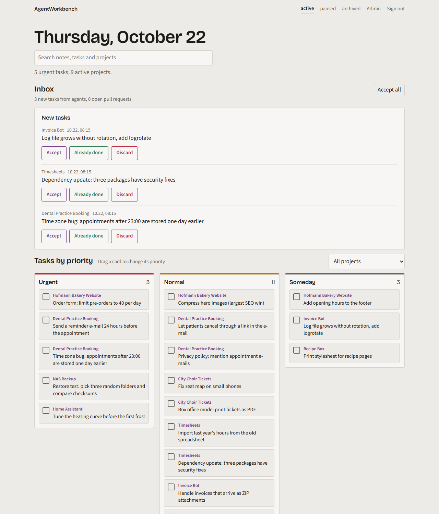
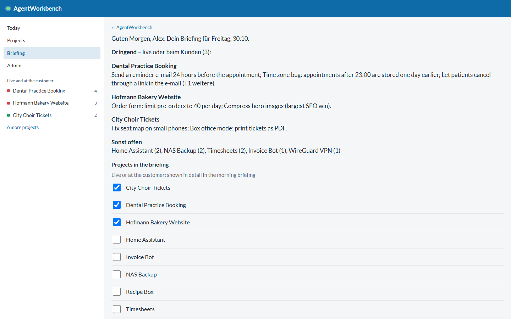
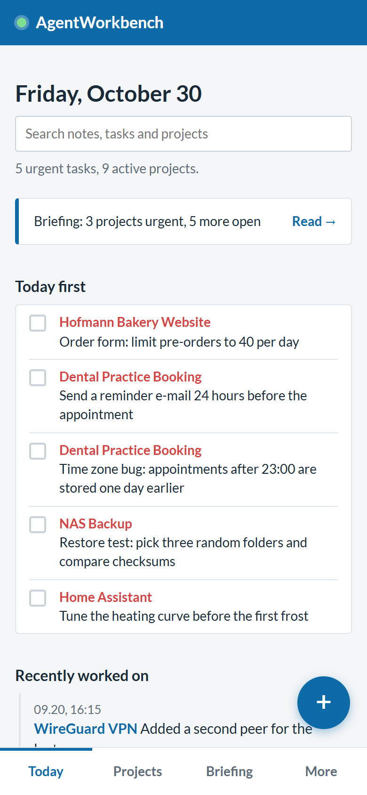
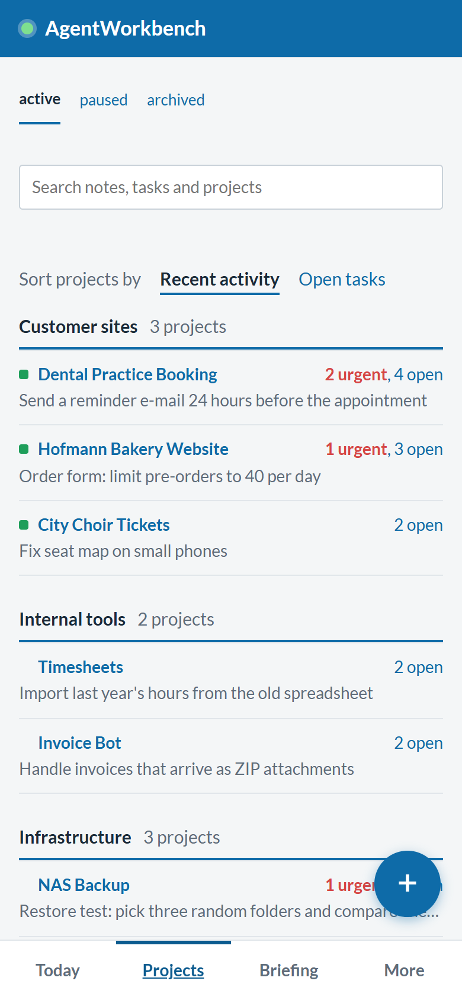

[](https://github.com/thom7e/agentworkbench/actions/workflows/ci.yml)
[](LICENSE)


[English](README.md) · Deutsch

```text
    ___                    __ _       __           __   __                    __
   /   | ____ ____  ____  / /| |     / /___  _____/ /__/ /_  ___  ____  _____/ /_
  / /| |/ __ `/ _ \/ __ \/ __/ | /| / / __ \/ ___/ //_/ __ \/ _ \/ __ \/ ___/ __ \
 / ___ / /_/ /  __/ / / / /_ | |/ |/ / /_/ / /  / ,< / /_/ /  __/ / / / /__/ / / /
/_/  |_\__, /\___/_/ /_/\__/ |__/|__/\____/_/  /_/|_/_.___/\___/_/ /_/\___/_/ /_/
      /____/
```

**Eine gemeinsame Sicht auf alle Projekte, für dich und deine KI-Agenten.**
Agenten beantworten Projektfragen mit etwa 36 bis 47 % weniger Tokens und weniger Schritten, bei gleicher Treffsicherheit.

```text
  ┌───────────────┐  push, briefing page   ┌──────────────────────────┐  briefing, tasks   ┌──────────────┐
  │      you      │◄───────────────────────│     A G E N T            │◄──────────────────►│   AI agents  │
  │ phone · web   │                        │     W O R K B E N C H    │  notes, log        │ Claude Code  │
  │ desktop       │───── tick off, add ───►│  FastAPI + SQLite        │                    │ and friends  │
  └───────────────┘                        └─────────────┬────────────┘                    └──────────────┘
                                                         │ checks: HTTP · DNS · port
                                                         ▼ close tasks by themselves
                                           ┌──────────────────────────┐
                                           │  your sites and servers  │
                                           └──────────────────────────┘
```

Was ein Agent vor dem Start bekommt (ein kurzer Text je Projekt):

```text
$ curl -H "Authorization: Bearer $TOKEN" https://your-host/api/projects/dental-booking

# Dental Practice Booking (dental-booking) — aktiv
Deploy: VPS
Stack: Django, PostgreSQL

## Recent notes
### #5 2026-10-30 09:15 (user)
The front desk wants to see the day list sorted by time, not by name.

## Open
- [ ] #6  (P1) Send a reminder e-mail 24 hours before the appointment
- [ ] #24 (P1) Time zone bug: appointments after 23:00 are stored one day earlier
- [ ] #7  (P2) Let patients cancel through a link in the e-mail

## Log
- 2026-10-30 16:15 Reminder e-mails drafted, waiting for the privacy text
```

Gemessen, nicht geschätzt: dieselben fünf Projektfragen, einmal aus Markdown-Notizen und einmal über AgentWorkbench, gleiches Modell, 25 Läufe je Zeile. Methode, Einschränkungen und Nachstellen: [Benchmark](benchmark/README.md#deutsch).

```text
  Tokens je Frage, weniger ist besser

  12 Projekte
  Markdown-Dateien █████████████████████████████████████    18.300
  AgentWorkbench   ████████████████████                      9.800  -47 %

  60 Projekte
  Markdown-Dateien ██████████████████████████████████████   18.900
  AgentWorkbench   ████████████████████████                 12.000  -36 %
```

<details>
<summary>Ganze Tabelle</summary>

| Projekte | Variante | Richtig | Tokens je Frage | Schritte | Kosten |
|---|---|---|---|---|---|
| 12 | Markdown-Dateien | 24 / 25 | 18.300 | 3,7 | 0,0076 $ |
| 12 | **AgentWorkbench** | 25 / 25 | **9.800** (-47 %) | 2,8 | 0,0055 $ (-28 %) |
| 60 | Markdown-Dateien | 25 / 25 | 18.900 | 4,0 | 0,0121 $ |
| 60 | **AgentWorkbench** | 25 / 25 | **12.000** (-36 %) | 2,8 | 0,0076 $ (-37 %) |

Der Gewinn ist bei Fragen über mehrere Projekte am größten ("was ist überall dringend?"). Eine einzelne Notiz nachzuschlagen ist ein Unentschieden. Die Testdaten sind klein und die Vergleichsdateien aufgeräumt, nimm es also als Anhaltspunkt.

</details>

AgentWorkbench ist ein kleines Dashboard zum Selbsthosten. Du öffnest es morgens (oder bekommst es als Benachrichtigung) und siehst, was zählt: was live und beim Kunden ist, was dringend ist, was deine Agenten getan haben und was sich auf GitHub geändert hat. Agenten wie [Claude Code](https://claude.com/claude-code) lesen vor der Arbeit ein kurzes Briefing, haken Aufgaben ab und hinterlassen Notizen für das nächste Mal. So muss nichts zweimal erklärt werden.

Ein FastAPI-Prozess, eine SQLite-Datei, kein Build-Schritt. Oberfläche auf Deutsch und Englisch, auf dem Handy als App installierbar.

<p align="center">
  
</p>
<p align="center">
  
</p>
<p align="center">
  
  
  
</p>

## Funktionen

**Überblick**
- **Heute zuerst**: alle dringenden Aufgaben über alle Projekte in einer Liste, direkt abhakbar.
- **Projekte** in Gruppen nach Wahl, mit einem **live**-Schalter für alles, was für Kunden oder produktiv läuft. Live-Projekte stehen mit einer Lampe im Seitenmenü, die rot wird, wenn etwas dringend ist.
- **Projektseiten** mit Reitern: Aufgaben und Ideen, Notizen, Dokumente und ein Verlauf-Reiter mit Protokoll, Git-Branches und letzten Commits.
- **Posteingang** für Aufgaben, die Agenten seit deinem letzten Blick angelegt haben: *Übernehmen*, *Bereits erledigt* oder *Verwerfen*. Offene Pull Requests erscheinen dort auch.
- **Prioritäts-Board** (Karte ziehen, um die Priorität zu ändern) und **Suche** über Notizen, Dokumente, Aufgaben und Projekte.

**Briefing und Automatik**
- **Morgen-Briefing** als Push-Benachrichtigung: Live-Projekte zuerst mit einer verständlichen Zeile pro Aufgabe, alles andere in einer Zeile, ein Hinweis auf Aufgaben, die länger als 30 Tage offen sind. Ein Tipp öffnet die Briefing-Seite, auf der du wählst, welche Projekte als live gelten.
- **Prüfregeln, die Aufgaben für dich abhaken**: Eine Aufgabe kann eine kleine Maschinenprüfung tragen (Seite liefert 200, Text vorhanden, Weiterleitung, DNS, offener Port). Ein täglicher Lauf hakt sie ab, schreibt einen Verlaufseintrag und benachrichtigt dich.
- **Notizen als Gedächtnis**: Notizen mit Zeitstempel von dir oder einem Agenten, anpinnbar. Agenten bekommen die angepinnten und die letzten Notizen bei jedem Briefing.

**Für Agenten**
- Ein kompaktes **Briefing** pro Projekt (Markdown, kurz), eine kleine **HTTP-API** mit widerrufbaren Tokens und ein fertiger [Claude-Code-Skill](examples/claude-code).

**Handy und Desktop**
- **Handy-App**: auf den Home-Bildschirm legen. Sie liest offline, hat einen Schnell-Eintrag mit Offline-Warteschlange, Wischen zum Abhaken, Ziehen zum Aktualisieren und Web-Push.
- **Passkey-Anmeldung** (Face ID, Touch ID, Windows Hello) neben dem Passwort.
- **Desktop-Terminal** (optional, Windows): Ein Knopf an jeder Aufgabe öffnet ein Terminal im Projektordner mit deinem KI-Agenten und der Aufgabe als Startauftrag.

**Betrieb**
- Optionale, nur lesende **Proxmox**-Anbindung (Status und IP pro Projekt), **Adminbereich** mit Einstellungen, Projekten, API-Zugängen, JSON-Backup und Markdown-Import. Helles und dunkles Design folgen deinem System.

## Schnellstart

### Docker (empfohlen)

```bash
git clone https://github.com/thom7e/agentworkbench.git
cd agentworkbench
docker compose up -d
```

Dann <http://localhost:8000> öffnen. Beim ersten Besuch legst du das Admin-Passwort fest. Die Daten liegen im Volume `agentworkbench-data`. Die Sprache stellst du unter **Verwaltung → Einstellungen** auf Deutsch.

Alternativ kannst du nach der ersten erfolgreichen `v*`-Image-Veröffentlichung durch einen Maintainer eine neue Installation ohne Klonen oder Bauen starten. Ersetze `vX.Y.Z` durch einen veröffentlichten Versionstag; der Workflow veröffentlicht kein `latest`:

```bash
docker run -d --name agentworkbench --restart unless-stopped \
  -p 127.0.0.1:8000:8000 -v agentworkbench-data:/data \
  ghcr.io/thom7e/agentworkbench:vX.Y.Z
```

Wähle eine Docker-Methode: Beide verwenden denselben Containernamen und Port. Hinweise zu vorhandenen Compose-Daten und zur Image-Verfügbarkeit stehen unter [Betrieb](docs/de/deployment.md#veröffentlichtes-docker-image).

### Python

```bash
git clone https://github.com/thom7e/agentworkbench.git
cd agentworkbench
python -m venv .venv && . .venv/bin/activate   # Windows: .venv\Scripts\activate
pip install -r requirements.txt
uvicorn app:app --host 0.0.0.0 --port 8000
```

### Mit Demodaten ausprobieren

```bash
AGENTWORKBENCH_DB=./demo.db python scripts/demo_seed.py
AGENTWORKBENCH_DB=./demo.db uvicorn app:app
```

Anmelden mit `demo-password-123`. Die Demo enthält erfundene Projekte, einen Posteingang, Notizen und Dokumente.

> Passkeys und Push-Benachrichtigungen brauchen HTTPS (eine echte Domain oder `localhost`). Siehe [Betrieb](docs/de/deployment.md#https-und-reverse-proxy).

## Dokumentation

| Anleitung | Inhalt |
|---|---|
| [Erste Schritte](docs/de/getting-started.md) | Erster Start, erstes Projekt, täglicher Ablauf |
| [Konfiguration](docs/de/configuration.md) | Jede Einstellung und Umgebungsvariable |
| [Briefing und Prüfregeln](docs/de/briefing-and-checks.md) | Der live-Schalter, Kurztitel, das Morgen-Briefing, Maschinenprüfungen |
| [Handy und Desktop](docs/de/phone-and-desktop.md) | Handy-App, Benachrichtigungen, Passkeys, das Desktop-Terminal |
| [Mit Agenten arbeiten](docs/de/agents.md) | Das Briefing, Notiz oder Protokoll, ein fertiger Claude-Code-Skill |
| [API-Referenz](docs/de/api.md) | Alle Endpunkte mit Beispielen |
| [Proxmox-Anbindung](docs/de/proxmox.md) | Lesender Token, Projekte mit Containern verknüpfen |
| [Betrieb](docs/de/deployment.md) | Docker, systemd, HTTPS, Zeitgeber, Backups, Updates, Passwort zurücksetzen |
| [Sicherheit](docs/de/security.md) | Was geschützt ist und was nicht |
| [Benchmark](benchmark/README.md#deutsch) | Tokens, Schritte und Kosten für Agenten: Dateien gegen AgentWorkbench, Methode und Einschränkungen |
| [Entwicklung](docs/de/development.md) | Aufbau, Tests, Übersetzungen, Screenshots |

Jede Anleitung gibt es auch auf Englisch im Ordner [`docs`](docs).

## Warum Agenten es mögen

Ein Agent muss wissen, was offen ist, was entschieden wurde und wo etwas läuft, ohne ganze Dateien zu lesen. Das Briefing ist ein kurzer Markdown-Text pro Projekt: offene Aufgaben mit Priorität, angepinnte und letzte Notizen, eine Liste der Dokumente (bei Bedarf lesen) und die letzten Protokolleinträge. Aufgaben tragen einen einzeiligen Titel, damit die Morgen-Zusammenfassung und das Briefing kurz bleiben. Prüfregeln schließen Aufgaben, ohne dass jemand Aufwand hat.

```bash
# Vor der Arbeit: was ist offen, was sollte ich wissen?
curl -H "Authorization: Bearer $TOKEN" https://dein-host/api/projects/mein-projekt

# Während der Arbeit
curl -X POST -H "Authorization: Bearer $TOKEN" https://dein-host/api/todos/42/done
curl -X POST -H "Authorization: Bearer $TOKEN" -H "Content-Type: application/json" \
     -d '{"text": "Entschieden: SQLite reicht, kein Postgres", "pinned": true}' \
     https://dein-host/api/projects/mein-projekt/notes

# Am Ende
curl -X POST -H "Authorization: Bearer $TOKEN" -H "Content-Type: application/json" \
     -d '{"text": "Login-Weiterleitung repariert"}' https://dein-host/api/projects/mein-projekt/log
```

Siehe [Mit Agenten arbeiten](docs/de/agents.md).

## Stand und Grenzen

- Ein Admin-Konto, keine Rechte pro Benutzer. Stelle die App hinter HTTPS, wenn sie aus dem Internet erreichbar ist, am besten mit einer Zugriffsschicht davor.
- Nur SQLite. Das reicht für Hunderte Projekte und viele tausend Aufgaben.
- Einige gespeicherte Werte sind aus historischen Gründen deutsch: Projektstatus `aktiv`, `pause`, `archiv` und Aufgabenart `todo`, `idee`. Die Oberfläche zeigt übersetzte Bezeichnungen. Die [API-Referenz](docs/de/api.md) nennt die genauen Werte.
- Dokumente und Notizen sind einfaches Markdown, beim Anzeigen bereinigt. Es gibt keine Datei-Uploads.
- Der Handler für das Desktop-Terminal ist für Windows.

## Mitmachen und Sicherheit

Siehe [CONTRIBUTING.md](CONTRIBUTING.md) und [SECURITY.md](SECURITY.md).

## Lizenz

[MIT](LICENSE)
