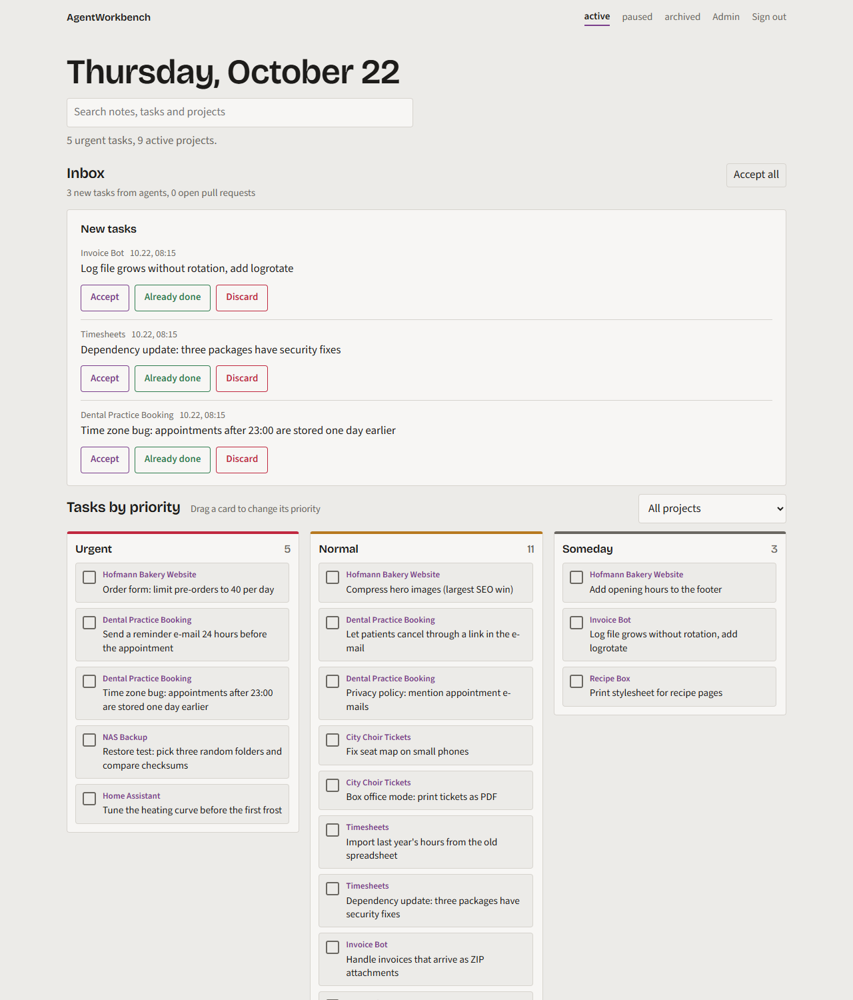
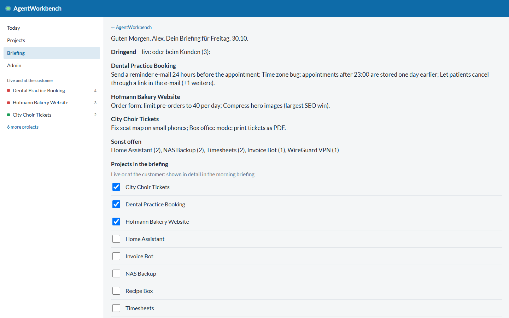
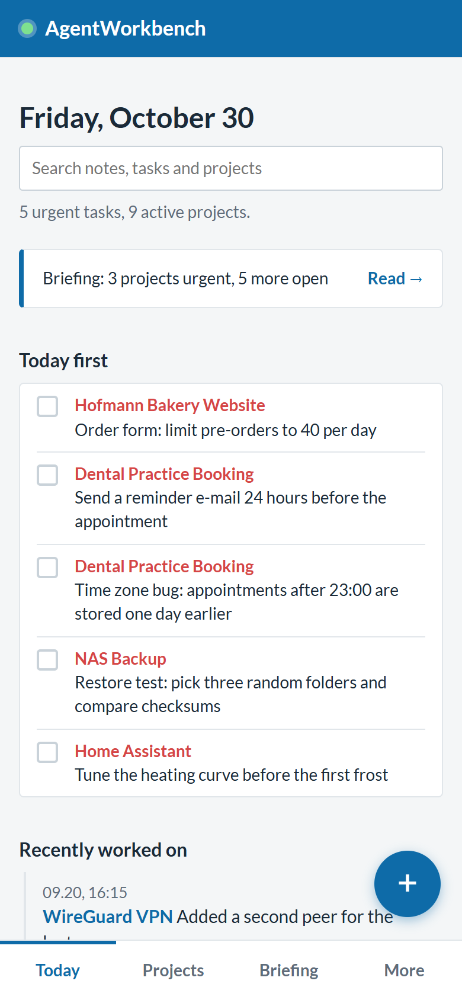
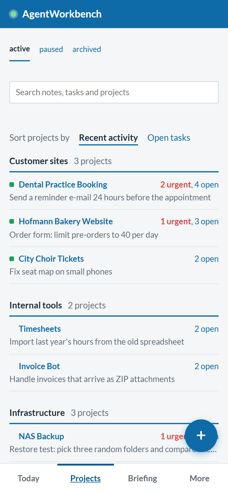

# AgentWorkbench

[](https://github.com/thom7e/agentworkbench/actions/workflows/ci.yml)

English · [Deutsch](README.de.md)

**One shared view of all your projects, for you and your AI agents. Your agents stop re-reading files and start with about 100 to 400 tokens of context.**

> **Why it saves tokens**
> Without shared memory, every agent session starts by reading notes, TODO files and old chats: easily 5,000 to 20,000 tokens, and the same again next time. AgentWorkbench hands the agent one short briefing per project instead.
>
> | Measured on a real instance (89 projects, 90 documents) | Tokens |
> |---|---|
> | Overview of all projects | about 1,700 |
> | Briefing of one project, median / average | about 120 / 420 |
> | Documents, read only when needed (average, per document) | about 2,600 |
>
> Estimated saving: **roughly 90 % of the context tokens per session**, from 5,000 to 20,000 down to a few hundred. Machine checks and the morning briefing run without any AI, so they cost no tokens at all. (The saving is an estimate based on typical note and TODO files. The sizes are measured, 1 token is counted as 3.6 characters.)

AgentWorkbench is a small self-hosted dashboard. You open it in the morning (or get it as a notification) and see what matters: what is live and at the customer, what is urgent, what your agents did and what changed on GitHub. Agents such as [Claude Code](https://claude.com/claude-code) read a short briefing before they start, tick off tasks and leave notes for the next time, so nothing has to be re-explained.

One FastAPI process, one SQLite file, no build step. English and German interface, installable on your phone.

<p align="center">
  
</p>
<p align="center">
  
  
  
</p>

## What it does

**Overview**
- **Today first**: every urgent task across all projects in one list, tick off in place.
- **Projects** in groups you define, with a *live* flag for what runs for customers or in production. Live projects are listed in the side menu with a lamp that turns red when something is urgent.
- **Project pages** with tabs: tasks and ideas, notes, documents, and an activity tab with the log, Git branches and latest commits.
- **Inbox** for tasks that agents created since you last looked: *Accept*, *Already done* or *Discard*. Open pull requests show up there too.
- **Priority board** (drag a card to change its priority) and **search** across notes, documents, tasks and projects.

**Briefing and automation**
- **Morning briefing** as a push notification: live projects first with one plain-language line per task, everything else in one line, a hint for tasks that stayed open for more than 30 days. Tapping it opens the briefing page where you choose which projects count as live.
- **Checks that close tasks for you**: a task can carry a small machine check (page returns 200, text present, redirect, DNS, open port). A daily run ticks it off, writes a log entry and notifies you.
- **Notes as memory**: timestamped notes from you or an agent, pinnable. Agents get the pinned and the latest notes with every briefing.

**For agents**
- A compact **briefing** per project (Markdown, short), a small **HTTP API** with revocable tokens, and a ready-made [Claude Code skill](examples/claude-code).

**Phone and desktop**
- **Phone app**: add it to the home screen. It reads offline, has a quick-add button with an offline queue, swipe to tick off, pull to refresh and web push.
- **Passkey sign-in** (Face ID, Touch ID, Windows Hello) next to the password.
- **Desktop terminal** (optional, Windows): a button on every task opens a terminal in the project folder with your AI agent and the task as its starting prompt.

**Operations**
- Optional read-only **Proxmox** integration (status and IP per project), **admin area** with settings, projects, API tokens, JSON backup and Markdown import. Light and dark theme follow your system.

## Quick start

### Docker (recommended)

```bash
git clone https://github.com/thom7e/agentworkbench.git
cd agentworkbench
docker compose up -d
```

Open <http://localhost:8000>. The first visit asks you to choose the admin password. Data lives in the `agentworkbench-data` volume.

### Python

```bash
git clone https://github.com/thom7e/agentworkbench.git
cd agentworkbench
python -m venv .venv && . .venv/bin/activate   # Windows: .venv\Scripts\activate
pip install -r requirements.txt
uvicorn app:app --host 0.0.0.0 --port 8000
```

### Try it with demo data

```bash
AGENTWORKBENCH_DB=./demo.db python scripts/demo_seed.py
AGENTWORKBENCH_DB=./demo.db uvicorn app:app
```

Sign in with `demo-password-123`. The demo contains fictional projects, an inbox, notes and documents.

> Passkeys and push notifications need HTTPS (a real domain, or `localhost`). See [Deployment](docs/deployment.md#https-and-reverse-proxy).

## Documentation

| Guide | Contents |
|---|---|
| [Getting started](docs/getting-started.md) | First run, first project, daily workflow |
| [Configuration](docs/configuration.md) | Every setting and environment variable |
| [Briefing and checks](docs/briefing-and-checks.md) | The live flag, short titles, the morning briefing, machine checks |
| [Phone and desktop](docs/phone-and-desktop.md) | Phone app, notifications, passkeys, the desktop terminal |
| [Working with agents](docs/agents.md) | The briefing, notes vs. log, a ready-made Claude Code skill |
| [API reference](docs/api.md) | All endpoints with examples |
| [Proxmox integration](docs/proxmox.md) | Read-only token, linking projects to containers |
| [Deployment](docs/deployment.md) | Docker, systemd, HTTPS, timers, backups, updates, password reset |
| [Security](docs/security.md) | What is protected, what is not |
| [Development](docs/development.md) | Project layout, tests, translations, screenshots |

Every guide is also available in German in [`docs/de`](docs/de).

## Why agents like it

An agent needs to know what is open, what was decided and where something runs, without reading whole files. The briefing is one short Markdown text per project: open tasks with priority, pinned and recent notes, a list of documents (read on demand) and the last log entries. Tasks carry a one-line title, so the morning summary and the briefing stay short, and checks close tasks without anyone spending effort on them.

```bash
# Before work: what is open, what should I know?
curl -H "Authorization: Bearer $TOKEN" https://your-host/api/projects/my-project

# While working
curl -X POST -H "Authorization: Bearer $TOKEN" https://your-host/api/todos/42/done
curl -X POST -H "Authorization: Bearer $TOKEN" -H "Content-Type: application/json" \
     -d '{"text": "Decided: SQLite is enough, no Postgres", "pinned": true}' \
     https://your-host/api/projects/my-project/notes

# When done
curl -X POST -H "Authorization: Bearer $TOKEN" -H "Content-Type: application/json" \
     -d '{"text": "Fixed the login redirect"}' https://your-host/api/projects/my-project/log
```

See [Working with agents](docs/agents.md).

## Status and limits

- One admin account, no per-user permissions. Put the app behind HTTPS if it is reachable from the internet, ideally with an access layer in front.
- SQLite only. It is plenty for hundreds of projects and many thousands of tasks.
- Some stored values are German for historical reasons: project status `aktiv`, `pause`, `archiv` and task kind `todo`, `idee`. The interface shows translated labels. The [API reference](docs/api.md) lists the exact values.
- Documents and notes are plain Markdown, sanitized when rendered. There are no file uploads.
- The desktop terminal handler is for Windows.

## Contributing and security

See [CONTRIBUTING.md](CONTRIBUTING.md) and [SECURITY.md](SECURITY.md).

## License

[MIT](LICENSE)
