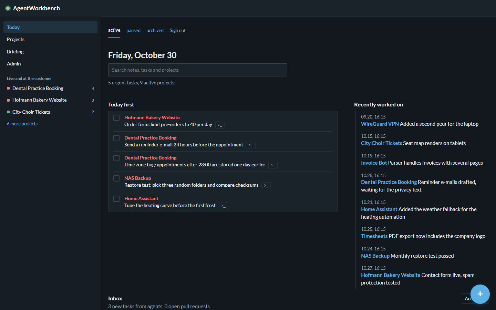
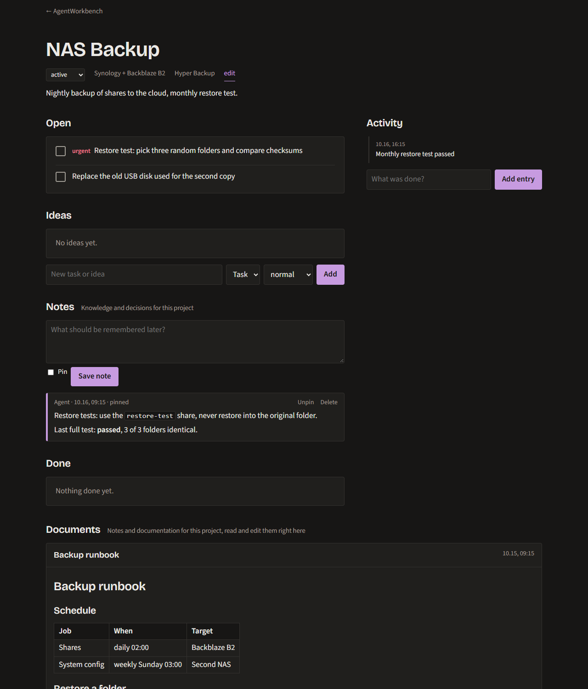

# AgentWorkbench

**One shared view of all your projects, for you and your AI agents.**

AgentWorkbench is a small self-hosted dashboard. You open it in the morning and see what matters: urgent tasks, a priority board across every project, what your agents did, and what changed on GitHub. Agents such as [Claude Code](https://claude.com/claude-code) read a briefing before they start, tick off tasks while they work, and leave notes for next time.

One FastAPI process, one SQLite file, no build step. English and German UI. Installable on your phone.

<p align="center">
  
</p>

<p align="center">
  
  
  
</p>

## What it does

- **Priority board** across all projects. Drag a card to change its priority (on phones, tap 1, 2 or 3).
- **Today first**: every urgent task in one list, check off in place.
- **Inbox** for tasks that agents created since you last looked, with three clear answers: *Accept*, *Already done*, *Discard*. Open pull requests show up there too.
- **Project pages** with tasks, ideas, activity log, branches, latest commits and a README excerpt from GitHub.
- **Notes as project memory**: timestamped notes from you or an agent, pinnable. Agents get the pinned and the latest notes in their briefing.
- **Documents** per project: Markdown pages you read and edit right on the project page.
- **Search** across notes, documents, tasks and projects.
- **Groups** you define (customers, hosting target, team ...), sorted by recent activity or open tasks, with a collapsed *dormant* section for quiet projects.
- **Infrastructure view** (optional): read-only Proxmox integration shows live status and IP per project and lists all containers and VMs, with a switch to hide stopped ones.
- **Admin area**: settings, projects, API tokens, JSON backup and Markdown import.
- **Agent API** with revocable tokens.
- **Morning briefing** as a push notification: live and customer projects first, one plain-language line per task (each task has a short title), a *longer open* hint for old tasks. Tapping it opens the briefing page, where you choose which projects count as *live*.
- **Checks that close tasks for you**: a task can carry a small machine check (page returns 200, text present, redirect, DNS, open port). A daily run ticks it off with a log entry once it passes.
- **Passkey sign-in** (WebAuthn) next to the password.
- **Phone app**: installable, works offline for reading, quick add with an offline queue, swipe to tick off, pull to refresh, web push.
- **Desktop terminal** (optional, Windows): a button on each task opens a terminal in the project folder with your AI agent and the task as its starting prompt.

## Quick start

### Docker (recommended)

```bash
git clone https://github.com/thom7e/agentworkbench.git
cd agentworkbench
docker compose up -d
```

Open <http://localhost:8000>. The first visit asks you to choose the admin password. Data lives in the `agentworkbench-data` volume.

### Python

```bash
git clone https://github.com/thom7e/agentworkbench.git
cd agentworkbench
python -m venv .venv && . .venv/bin/activate   # Windows: .venv\Scripts\activate
pip install -r requirements.txt
uvicorn app:app --host 0.0.0.0 --port 8000
```

### Try it with demo data

```bash
AGENTWORKBENCH_DB=./demo.db python scripts/demo_seed.py
AGENTWORKBENCH_DB=./demo.db uvicorn app:app
```

Sign in with `demo-password-123`. The demo contains fictional projects, an inbox, notes and documents.

## Documentation

| Guide | Contents |
|---|---|
| [Getting started](docs/getting-started.md) | First run, first project, daily workflow |
| [Configuration](docs/configuration.md) | Every setting and environment variable |
| [Working with agents](docs/agents.md) | The briefing, notes vs. log, a ready-made Claude Code skill |
| [API reference](docs/api.md) | All endpoints with examples |
| [Proxmox integration](docs/proxmox.md) | Read-only token, linking projects to containers |
| [Deployment](docs/deployment.md) | Docker, systemd, HTTPS, backups, updates, password reset |
| [Security](docs/security.md) | What is protected, what is not |
| [Development](docs/development.md) | Project layout, tests, translations, screenshots |

A German summary is in [README.de.md](README.de.md).

## How agents use it

```bash
# Before work: what is open, what should I know?
curl -H "Authorization: Bearer $TOKEN" https://your-host/api/projects/my-project

# While working
curl -X POST -H "Authorization: Bearer $TOKEN" https://your-host/api/todos/42/done
curl -X POST -H "Authorization: Bearer $TOKEN" -H "Content-Type: application/json" \
     -d '{"text": "Decided: SQLite is enough, no Postgres", "pinned": true}' \
     https://your-host/api/projects/my-project/notes

# When done
curl -X POST -H "Authorization: Bearer $TOKEN" -H "Content-Type: application/json" \
     -d '{"text": "Fixed the login redirect"}' https://your-host/api/projects/my-project/log
```

A ready-made skill for Claude Code is in [`examples/claude-code`](examples/claude-code). See [Working with agents](docs/agents.md).

## Status and limits

- One admin account, no per-user permissions. Put the app behind HTTPS if it is reachable from the internet.
- SQLite only. It is plenty for hundreds of projects and many thousands of tasks.
- Some stored values are German for historical reasons: project status `aktiv`, `pause`, `archiv` and task kind `todo`, `idee`. The UI shows translated labels. The [API reference](docs/api.md) lists the exact values.
- Documents and notes are plain Markdown, sanitized when rendered. There are no file uploads.

## License

[MIT](LICENSE)
